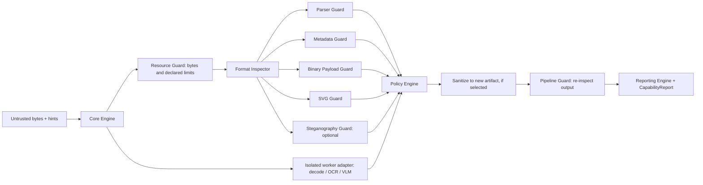

# Pixwarden Technical Requirements and Design

**Document ID:** PW-TRD · **Version:** 0.1.0 · **Status:** Phase 0/1 baseline · **Updated:** 2026-11-13

## 1. Architecture and trust boundaries

Untrusted bytes and caller-supplied names/MIME are tainted. Format sniffers and parsers are attack surface; native decoders are high-risk components. The trusted core orchestrates only bounded interfaces and does not execute embedded content or fetch URLs. A library process cannot promise hard CPU/memory limits against native code; deployments needing those guarantees MUST put decode/OCR/model work in a killable worker/container with OS quotas, no network, read-only input, restricted filesystem and protocol-enforced deadline (SEC-001).



```mermaid
sequenceDiagram
  participant App
  participant Core
  participant Inspectors
  participant Worker
  participant Policy
  App->>Core: bytes + options + limits
  Core->>Core: validate options, hash optionally, count bytes
  Core->>Inspectors: read-only bounded inspection
  Inspectors-->>Core: findings + control states
  opt decoder/OCR configured
    Core->>Worker: opaque input reference, limits, no network
    Worker-->>Core: result or timeout/error
  end
  Core->>Policy: findings + required capabilities
  Policy-->>Core: allow/sanitize/reject/review
  opt sanitize decision
    Core->>Worker: transform to new artifact
    Worker-->>Core: output bytes + transform metadata
    Core->>Inspectors: post-check output
  end
  Core-->>App: typed report; artifact only when produced
```

## 2. Modules and contracts

| Module | Contract / responsibility | Forbidden behavior |
|---|---|---|
| Core Engine | Immutable request, cancellation, state machine, normalized errors | Fail-open, hidden network, writing source |
| Format Inspector | Candidate format + confidence/reasons + hint mismatch | Trusting extension/MIME as ground truth |
| Parser Guard | Format profile checks, offset-bounded evidence | Invoking renderer or active content |
| SVG Guard | Hardened XML parse; namespace-aware policy/allowlist serialization | Regex-only sanitizer, entities/network resolution |
| Metadata Guard | Parse known metadata under byte/depth/count bounds; strip/preserve/reject | Unbounded extraction or default logging of values |
| Binary Payload Guard | Signatures, terminator/trailing data, bounded entropy/embedded container indicators | Executing or recursively unpacking payloads |
| Steganography Guard | Explicit named statistical tests, bounded samples, uncertainty | Claiming universal detection |
| Resource Guard | Enforceable in-process counters plus capability declaration for external quotas | Claim hard memory/CPU control where none exists |
| Raster Sanitizer | Adapter decode/re-encode to allowlisted output, new artifact | Overwriting input or trusting generated output |
| AI Injection Guard | Optional OCR/text/context detectors; advisory findings | Executing extracted instructions or forcing remote API |
| Pipeline Guard | Mandatory-control completion and output reinspection | Treating missing checks as passed |
| Policy Engine | Deterministic policy evaluation over findings and controls | Implicit default allow on error |
| Reporting Engine | Versioned stable JSON-compatible result | Unnecessary private data in logs |

Every module returns typed findings/control states (`passed`, `failed`, `skipped`, `unsupported`, `error`) and bounded evidence. Control errors are not converted into absence of findings.

## 3. Processing and resource model

Accept bytes, byte stream, or caller-managed file handle; never fetch a URL. Stream ingress into a size-limited spool only when required; temporary files use exclusive creation, restrictive permissions, random names, cleanup in `finally`, and caller-configurable private temp root. Avoid predictable paths and shell commands. Input is immutable. Cancellation is cooperative for synchronous parsing and effective only at checkpoints; a worker protocol is required to terminate a wedged native decoder.

Preflight overflow-safe arithmetic before allocating: dimensions, pixel product, stride, frames, metadata bytes/count/depth, nesting and input length. Defaults are policy-versioned and conservative; no numeric defaults are asserted until benchmarked. Caller values may tighten defaults; only explicitly privileged configuration may loosen policy maxima. In-process accounting can cap bytes, loops, allocations controlled by Pixwarden and concurrency, but cannot reliably cap native decoder memory or CPU. Worker/container adapter must enforce wall time, CPU, RSS, process count and no-network capability and report observed enforcement.

## 4. Format parsing and decoding

Signature sniffing yields candidate(s); parsers use checked arithmetic and strict bounds. Format profiles identify permitted chunk/marker ordering, duplicate/unknown chunks, trailers and animation structure. Parser disagreement should be a finding, not resolved by selecting the most permissive result. Restrict enabled decoders at build/deployment and expose actual capabilities. Keep dependency versions pinned by lockfiles; monitor upstream advisories; rebuild native dependencies promptly.

Raster sanitizer: decode only in approved adapter, enforce dimensions/frame/working-set limits, select explicit output format, remove metadata by default, encode to new bytes, then independently inspect/decode/post-check output. Animation is either preserved under per-frame controls or explicitly flattened/rejected; never silently discard frames. Re-encoding is risk reduction, not proof of cleanliness.

SVG: use a maintained XML parser with DTD/external entity/network access disabled, depth/node/text/attribute limits. Parse namespaces; reject malformed/ambiguous namespace use. Allowlist elements/attributes and safe style properties, remove script/event handlers/external references/foreignObject/embedded payloads by default, validate fragment references and URL schemes, serialize from parsed nodes (not string substitution), then parse and scan result. Output intended for document embedding receives stricter policy than image mode; caller must serve with appropriate content type and isolation.

## 5. Optional analysis

Metadata supports explicit retain, strip and reject actions. Binary inspection is read-only: scan format-defined gaps/segments and bounded tail; recognize known signatures and nested container indicators; record offsets/hash/length rather than payload. Entropy is heuristic and contextual only. No recursive unpacking by default.

Steganography offers named statistical methods, format applicability and sampling rules; tests must include benign controls and false-positive measurement. No universal detection. Mitigation may strip alpha/metadata, flatten transparency, quantize/re-encode or render/reconstruct; visual and semantic loss must be disclosed. OCR/VLM adapters accept only bytes/artifact references, are optional, disabled by default, have explicit data-egress consent/configuration, timeout and response schema, and never run extracted text as instructions. AI findings are advisory absent a user policy.

## 6. Policies, errors and reports

Policy declares mandatory controls, unsupported-format behavior, inconclusive behavior, findings thresholds, metadata action, sanitizer requirement and final action. Default policy for public uploads: unsupported/mandatory skipped/error => `review` or `reject`, never `allow`; SVG active-document delivery requires `sanitize` or `reject`. Report distinguishes validity, decoder outcome, sanitized status, compliance, coverage and residual risks.

Errors are stable `EngineError` codes with stage, retryability, safe message and optional internal cause excluded from public JSON. Include cancelled, timeout, limit exceeded, unsupported format/capability, malformed input, decoder failure, policy failure, IO failure. No raw paths or parser secrets in public errors.

## 7. JSON, parity and compatibility

JSON Schema Draft 2020-12 is the candidate shared schema dialect. Schema and semantic rules version independently via `specVersion` and `reportVersion`; additive optional fields are minor, changed meanings/removals are major. Unknown enum values are rejected by strict consumers or retained as opaque data by forward-compatible readers. PHP and JS serialize canonical enum strings and UTC RFC 3339 timestamps; evidence ordering and finding IDs are deterministic.

JS: Node.js LTS, TypeScript strict, ESM first, CJS only if packaging and dependencies allow without semantic drift, Buffer/Uint8Array/Readable, AbortSignal. PHP: 8.2+, Composer PSR-4, strict types, framework-neutral objects, streams/resources and exceptions. Native decoder availability varies; no common capability may be advertised unless both implementations pass conformance or a documented runtime capability is emitted.

## 8. ADRs

* **ADR-001 — Independent runtime implementations.** Chosen to prevent cross-runtime dependencies and preserve native integration. Trade-off: duplicate code and require conformance vectors.
* **ADR-002 — Inspect vs decode vs sanitize capabilities.** Chosen because a signature/parser can inspect without a decoder, and decoder availability is build-specific. Trade-off: richer capability reporting.
* **ADR-003 — Out-of-process enforcement for hard quotas.** Chosen because library-level timers cannot stop blocked native code or enforce RSS/CPU. Trade-off: worker deployment complexity; core does not overclaim.
* **ADR-004 — SVG allowlist parsing.** Chosen over regex filtering due to XML namespaces, nested syntax and active features. Trade-off: some legitimate SVG features are removed.
* **ADR-005 — No remote fetching in core.** Chosen to avoid SSRF and implicit egress. Callers must explicitly fetch and pass bytes through their own guarded retrieval layer.
* **ADR-006 — Apache-2.0 remains a proposal, current checkout is MIT.** Both MIT and Apache-2.0 are OSI-approved permissive licenses. MIT has a short notice-retention condition and broad permission but no express patent grant; Apache-2.0 adds an express contributor patent grant and patent-litigation termination clause, plus more detailed notice/modified-file obligations. Neither is a “no reuse” license; prohibiting reuse is incompatible with OSI-approved open source licensing. The current root `LICENSE` is MIT, so this documentation does not change it. Decide deliberately for each future repository, verify all dependency and corpus licenses, copyright ownership/contributor rights, and distribution notices before implementation or publication. References: [OSI MIT text](https://opensource.org/license/mit), [OSI Apache-2.0 text](https://opensource.org/license/apache-2-0), consulted 2026-11-13.

## 9. Testing, CI/CD and release

Shared corpus drives cross-runtime conformance, parser regression, malformed-input tests, property-based tests and fuzz harnesses. Sanitization tests compare visual metrics only as supporting evidence, never security proof. Benchmarks specify OS/CPU/RAM/runtime/decoder versions and include limits. CI runs lint/static analysis/unit/integration/conformance/dependency audit/build; scheduled fuzzing stores minimized reproducers and never operational payloads. Releases are manual, signed/tagged where possible, with provenance/SBOM and advisory review. No auto-publish.

## 10. Sources

[OWASP File Upload](https://cheatsheetseries.owasp.org/cheatsheets/File_Upload_Cheat_Sheet.html); [ImageMagick security policy](https://imagemagick.org/security-policy/); [JSON Schema 2020-12](https://json-schema.org/specification); [PHP GD](https://www.php.net/manual/en/book.image.php); [MDN SVG scripting](https://developer.mozilla.org/en-US/docs/Web/SVG/Guides/Scripting). Accessed 2026-11-13.
