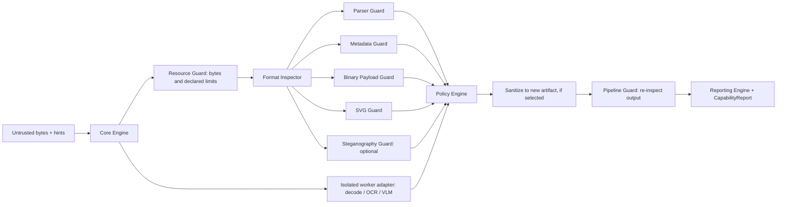

# Pixwarden Technical Requirements and Design

**Document ID:** PW-TRD · **Version:** 0.1.0 · **Status:** Phase 2 in progress · **Updated:** 2026-11-14

## 1. Architecture and trust boundaries

Untrusted bytes and caller-supplied names/MIME are tainted. Format sniffers and parsers are attack surface; native decoders are high-risk components. The trusted core orchestrates only bounded interfaces and does not execute embedded content or fetch URLs. JS `scanImageIsolated` uses a terminable worker thread to enforce a parent-managed wall-clock timeout and V8 old-generation heap ceiling for the current pure-JS inspection path. It does not claim OS-level isolation or total RSS/CPU quotas. Deployments needing those guarantees for native decode/OCR/model work MUST use a child process/container with OS quotas, no network, read-only input, restricted filesystem and protocol-enforced deadline (SEC-001).



```mermaid
sequenceDiagram
  participant App
  participant Core
  participant Inspectors
  participant Worker
  participant Policy
  App->>Core: bytes + options + limits
  Core->>Core: validate options, hash optionally, count bytes
  Core->>Inspectors: read-only bounded inspection
  Inspectors-->>Core: findings + control states
  opt decoder/OCR configured
    Core->>Worker: opaque input reference, limits, no network
    Worker-->>Core: result or timeout/error
  end
  Core->>Policy: findings + required capabilities
  Policy-->>Core: allow/sanitize/reject/review
  opt sanitize decision
    Core->>Worker: transform to new artifact
    Worker-->>Core: output bytes + transform metadata
    Core->>Inspectors: post-check output
  end
  Core-->>App: typed report; artifact only when produced
```

## 2. Modules and contracts

| Module | Contract / responsibility | Forbidden behavior |
|---|---|---|
| Core Engine | Immutable request, cancellation, state machine, normalized errors | Fail-open, hidden network, writing source |
| Format Inspector | Candidate format + confidence/reasons + hint mismatch | Trusting extension/MIME as ground truth |
| Parser Guard | Format profile checks, offset-bounded evidence | Invoking renderer or active content |
| SVG Guard | Hardened XML parse; namespace-aware policy/allowlist serialization | Regex-only sanitizer, entities/network resolution |
| Metadata Guard | Parse known metadata under byte/depth/count bounds; strip/preserve/reject | Unbounded extraction or default logging of values |
| Binary Payload Guard | Signatures, terminator/trailing data, bounded entropy/embedded container indicators | Executing or recursively unpacking payloads |
| Steganography Guard | Explicit named statistical tests, bounded samples, uncertainty | Claiming universal detection |
| Resource Guard | Enforceable in-process counters plus capability declaration for external quotas | Claim hard memory/CPU control where none exists |
| Raster Sanitizer | Adapter decode/re-encode to allowlisted output, new artifact | Overwriting input or trusting generated output |
| AI Injection Guard | Optional OCR/text/context detectors; advisory findings | Executing extracted instructions or forcing remote API |
| Pipeline Guard | Mandatory-control completion and output reinspection | Treating missing checks as passed |
| Policy Engine | Deterministic policy evaluation over findings and controls | Implicit default allow on error |
| Reporting Engine | Versioned stable JSON-compatible result | Unnecessary private data in logs |

Every module returns typed findings/control states (`passed`, `failed`, `skipped`, `unsupported`, `error`) and bounded evidence. Control errors are not converted into absence of findings.

## 3. Processing and resource model

Accept bytes, byte stream, or caller-managed file handle; never fetch a URL. Stream ingress into a size-limited spool only when required; temporary files use exclusive creation, restrictive permissions, random names, cleanup in `finally`, and caller-configurable private temp root. Avoid predictable paths and shell commands. Input is immutable. Cancellation is cooperative for synchronous parsing and effective only at checkpoints; a worker protocol is required to terminate a wedged native decoder. The PHP `scanStream()` ingress reads from the current position, leaves ownership with the caller, and buffers no more than its configured byte cap plus one overflow byte. It does not enforce a wall-clock timeout; callers must configure blocking-stream timeouts.

Preflight overflow-safe arithmetic before allocating: dimensions, pixel product, stride, frames, metadata bytes/count/depth, nesting and input length. Defaults are policy-versioned and conservative; no numeric defaults are asserted until benchmarked. Caller values may tighten defaults; only explicitly privileged configuration may loosen policy maxima. In-process accounting can cap bytes, loops, allocations controlled by Pixwarden and concurrency, but cannot reliably cap native decoder memory or CPU. Worker/container adapter must enforce wall time, CPU, RSS, process count and no-network capability and report observed enforcement.

## 4. Format parsing and decoding

Signature sniffing yields candidate(s); parsers use checked arithmetic and strict bounds. Format profiles identify permitted chunk/marker ordering, duplicate/unknown chunks, trailers and animation structure. Parser disagreement should be a finding, not resolved by selecting the most permissive result. Restrict enabled decoders at build/deployment and expose actual capabilities. Keep dependency versions pinned by lockfiles; monitor upstream advisories; rebuild native dependencies promptly.

Current restricted PNG raster sanitizer: only static non-interlaced 8-bit RGBA, at most 1,000,000 pixels and 10 MiB input. It uses bounded zlib inflation to the exact expected scanline length, rejects trailing compressed bytes, reconstructs PNG filters, strips all ancillary chunks, encodes a minimal PNG, and structurally/post-pixel checks output. PHP uses ext-zlib; no native image decoder is required. ICC/gamma/color chunks are dropped and visual appearance may change. The bound is not an OS CPU/RSS quota and the API does not cover other formats, bit depths, interlace, or animation. A future general sanitizer still requires a separately reviewed decoder/adapter and isolation.

SVG: JS uses Saxes and PHP optionally uses ext-dom; both reject DTDs and processing instructions, enforce UTF-8/input/node/depth/attribute/output bounds, parse namespaces, apply narrow element/attribute allowlists, remove active/external features, validate local fragment references, serialize parsed nodes (not string substitution), and parse the output again. No CSS/style, filter, animation, external reference, or general renderer is implied. Output intended for document embedding receives stricter policy than image mode; caller must serve with appropriate content type and isolation. The runtime parser implementations differ, so shared vectors and differential tests are mandatory.

## 5. Optional analysis

Metadata supports explicit retain, strip and reject actions. Binary inspection is read-only: scan format-defined gaps/segments and bounded tail; recognize known signatures and nested container indicators; record offsets/hash/length rather than payload. Entropy is heuristic and contextual only. No recursive unpacking by default.

The current optional steganography profile reports per-channel LSB balance and nonzero RGB values in fully transparent pixels for static RGBA8 PNGs only. It reports descriptive scores without thresholds, remains inconclusive, and never passes the required policy control. Broader steganalysis methods require separate source-specific research and false-positive evaluation. No universal detection. Mitigation may strip alpha/metadata, flatten transparency, quantize/re-encode or render/reconstruct; visual and semantic loss must be disclosed. OCR/VLM adapters accept only bytes/artifact references, are optional, disabled by default, have explicit data-egress consent/configuration, timeout and response schema, and never run extracted text as instructions. AI findings are advisory absent a user policy.

## 6. Policies, errors and reports

Policy declares mandatory controls, unsupported-format behavior, inconclusive behavior, findings thresholds, metadata action, sanitizer requirement and final action. Default policy for public uploads: unsupported/mandatory skipped/error => `review` or `reject`, never `allow`; SVG active-document delivery requires `sanitize` or `reject`. Report distinguishes validity, decoder outcome, sanitized status, compliance, coverage and residual risks.

Errors are stable `EngineError` codes with stage, retryability, safe message and optional internal cause excluded from public JSON. Include cancelled, timeout, limit exceeded, unsupported format/capability, malformed input, decoder failure, policy failure, IO failure. No raw paths or parser secrets in public errors.

## 7. JSON, parity and compatibility

JSON Schema Draft 2020-12 is the candidate shared schema dialect. Schema and semantic rules version independently via `specVersion` and `reportVersion`; additive optional fields are minor, changed meanings/removals are major. Unknown enum values are rejected by strict consumers or retained as opaque data by forward-compatible readers. PHP and JS serialize canonical enum strings and UTC RFC 3339 timestamps; evidence ordering and finding IDs are deterministic.

JS: Node.js LTS, TypeScript strict, ESM first, CJS only if packaging and dependencies allow without semantic drift, Buffer/Uint8Array/Readable, AbortSignal. PHP: 8.2+, Composer PSR-4, strict types, framework-neutral objects, streams/resources and exceptions. Native decoder availability varies; no common capability may be advertised unless both implementations pass conformance or a documented runtime capability is emitted.

## 8. ADRs

* **ADR-001 — Independent runtime implementations.** Chosen to prevent cross-runtime dependencies and preserve native integration. Trade-off: duplicate code and require conformance vectors.
* **ADR-002 — Inspect vs decode vs sanitize capabilities.** Chosen because a signature/parser can inspect without a decoder, and decoder availability is build-specific. Trade-off: richer capability reporting.
* **ADR-003 — Isolate work according to the resource boundary.** JS byte inspection can run in a terminable worker thread with a wall-clock timeout and V8 heap ceiling. Native decoder/OCR/model work requiring OS CPU or RSS quotas belongs in a child process/container. Trade-off: workers improve cancellation responsiveness but are not a process security boundary.
* **ADR-004 — SVG allowlist parsing.** Chosen over regex filtering due to XML namespaces, nested syntax and active features. Trade-off: some legitimate SVG features are removed.
* **ADR-005 — No remote fetching in core.** Chosen to avoid SSRF and implicit egress. Callers must explicitly fetch and pass bytes through their own guarded retrieval layer.
* **ADR-006 — Apache-2.0 remains a proposal, current checkout is MIT.** Both MIT and Apache-2.0 are OSI-approved permissive licenses. MIT has a short notice-retention condition and broad permission but no express patent grant; Apache-2.0 adds an express contributor patent grant and patent-litigation termination clause, plus more detailed notice/modified-file obligations. Neither is a “no reuse” license; prohibiting reuse is incompatible with OSI-approved open source licensing. The current root `LICENSE` is MIT, so this documentation does not change it. Decide deliberately for each future repository, verify all dependency and corpus licenses, copyright ownership/contributor rights, and distribution notices before implementation or publication. References: [OSI MIT text](https://opensource.org/license/mit), [OSI Apache-2.0 text](https://opensource.org/license/apache-2-0), consulted 2026-11-13.
* **ADR-007 — Saxes 6.0.0 for SVG parsing, with a strict allowlist serializer.** Chosen for namespace-aware XML 1.0 parsing and a parser interface with no URL/file resolver. Pixwarden rejects every `DOCTYPE` event and never adds DTD entities. Its documented limitations say DTD contents are not thoroughly parsed; the pre-acceptance rejection, UTF-8/input/node/depth/output bounds, and isolated hostile-workload guidance are therefore required. ISC-licensed parser is a runtime dependency; its last npm release is old, so the upstream source, advisory state, license, and maintenance status must be rechecked before each release. It is used for syntax, not SVG rendering. References: [Saxes documentation](https://github.com/lddubeau/saxes), [npm package metadata](https://www.npmjs.com/package/saxes), [OWASP XXE guidance](https://cheatsheetseries.owasp.org/cheatsheets/XML_External_Entity_Prevention_Cheat_Sheet.html), consulted 2026-11-13.
* **ADR-008 — PHP ext-dom for optional SVG parsing.** Reuse PHP's DOM/libxml parser with `LIBXML_NONET`, no DTD loading/entity substitution, and a pre-parse DTD/entity rejection. This keeps the package free of mandatory runtime dependencies and reports SVG unsupported when ext-dom is absent. The output uses a PHP DOM parse and a narrow allowlist serializer followed by a post-check. Runtime parser differences remain a conformance risk; shared cross-runtime vectors are required.
* **ADR-009 — Opis JSON Schema for PHP contract tests only.** Use `opis/json-schema` 2.6.2 as a development dependency to validate PHP reports against the shared Draft 2020-12 schema in CI. The library documents support for Draft 2020-12 and Apache-2.0 licensing; it is absent from runtime `require`, so Pixwarden PHP remains dependency-free for consumers. Schema validation is local and does not fetch remote documents. Recheck its advisory and license status before releases. References: [Opis JSON Schema repository](https://github.com/opis/json-schema), [Opis validator API](https://opis.io/json-schema/2.x/php-validator.html), consulted 2026-11-14.
* **ADR-010 — Jazzer.js for scheduled JS parser and sanitizer fuzzing.** Use Jazzer.js 4.0.0 as a development-only coverage-guided fuzzer for the bounded byte scanner and, for detected SVG inputs, the static sanitizer/post-check path. Targets assert input immutability and sanitizer idempotence; expected malformed/limit rejects remain normal outcomes. PR CI replays seeds; weekly/manual runs are capped by libFuzzer duration, maximum input size, per-input timeout and an outer Actions job timeout. Findings remain untrusted byte inputs and are never executed. The package and its fuzzer engine are Apache-2.0 licensed. This is in-process fuzzing and does not establish an OS CPU/RSS boundary; it does not cover native decoders because Pixwarden does not invoke one. References: [Jazzer.js repository and usage](https://github.com/CodeIntelligenceTesting/jazzer.js), consulted 2026-11-14.
* **ADR-011 — nikic/php-fuzzer for native PHP parser and sanitizer fuzzing.** Use nikic/php-fuzzer 0.0.11 as a development-only coverage-guided fuzzer for PHP's bounded byte scanner and, for detected SVG inputs, sanitizer output metadata and idempotence. The target raises on sanitizer post-check failures rather than treating them as normal malformed-input rejects. Pull requests run a fixed iteration batch; scheduled/manual jobs stop after 90 seconds and upload evolving corpus/crash artifacts. It also checks runtime failures, report serialization/enums, input immutability and evidence bounds. The MIT-licensed tool remains outside runtime dependencies. Its `pcntl` timeout and Actions wall-clock limit do not impose OS memory/CPU quotas. References: [PHP-Fuzzer repository and target contract](https://github.com/nikic/PHP-Fuzzer), [Packagist release/dependencies/license](https://packagist.org/packages/nikic/php-fuzzer), consulted 2026-11-14.
* **ADR-012 — Implement one bounded RGBA8 PNG reconstruction profile without a general decoder dependency.** The first raster transform is limited to static non-interlaced 8-bit RGBA PNGs, 1,000,000 pixels and 10 MiB. JS uses Node zlib with a maximum decompressed output and consumed-byte accounting; PHP requires optional ext-zlib, checks the output ceiling, stream end, and bytes consumed. Both reconstruct PNG filters, discard all ancillary chunks, write a minimal PNG, post-check pixels and structure, and run the same harmless vectors. This avoids exposing arbitrary native image coders or adding mandatory runtime dependencies, but it is not general format support and does not provide OS CPU/RSS isolation. ICC/gamma removal may change appearance; pixel-level hidden content remains. The profile follows [PNG Third Edition](https://www.w3.org/TR/png-3/) and uses the official [Node.js zlib API](https://nodejs.org/api/zlib.html), [PHP zlib_decode](https://www.php.net/manual/en/function.zlib-decode.php), and [PHP inflate_get_read_len](https://www.php.net/manual/en/function.inflate-get-read-len.php) contracts, consulted 2026-11-14. Any broader decoder requires its own security review and process isolation.

## 9. Testing, CI/CD and release

Shared corpus drives cross-runtime conformance, parser regression, malformed-input tests, property-based tests and fuzz harnesses. Sanitization tests compare visual metrics only as supporting evidence, never security proof. Benchmarks specify OS/CPU/RAM/runtime/decoder versions and include limits. CI runs lint/static analysis/unit/integration/conformance/dependency audit/build; scheduled fuzzing stores minimized reproducers and never operational payloads. Releases are manual, signed/tagged where possible, with provenance/SBOM and advisory review. No auto-publish.

## 10. Sources

[OWASP File Upload](https://cheatsheetseries.owasp.org/cheatsheets/File_Upload_Cheat_Sheet.html); [ImageMagick security policy](https://imagemagick.org/security-policy/); [JSON Schema 2020-12](https://json-schema.org/specification); [PHP GD](https://www.php.net/manual/en/book.image.php); [MDN SVG scripting](https://developer.mozilla.org/en-US/docs/Web/SVG/Guides/Scripting). Accessed 2026-11-13.
