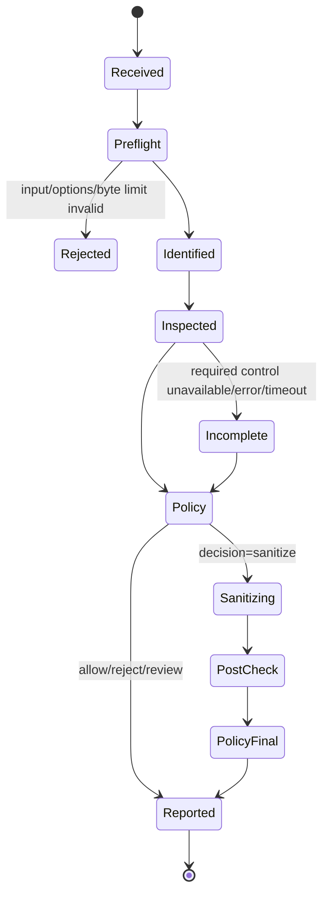

# Pixwarden Application Flows

**Document ID:** PW-FLOW · **Version:** 0.1.0 · **Status:** Phase 0/1 baseline · **Updated:** 2026-11-13

## 1. Main scan flow

1. **Receive:** caller supplies bytes/stream and untrusted filename/MIME hints; API never accepts a URL for implicit retrieval.
2. **Identify:** count bytes while reading, enforce `maxBytes`, compute digest only if requested, detect candidate signatures; report conflicting/multiple candidates.
3. **Prevalidate:** validate option ranges and policy; reject impossible limits before parse.
4. **Structural inspection:** parse only enabled supported profiles with overflow-safe offsets; malformed/truncated/inconsistent structures become findings or typed errors.
5. **Metadata inspection:** scan bounded known metadata segments; apply retain/strip/reject policy without logging values.
6. **Active content:** SVG receives secure XML parsing and allowlist evaluation. Raster active content means format-defined ancillary payloads, not execution.
7. **Binary inspection:** scan trailers, gaps and known auxiliary blocks; report bounded signatures and entropy indicators. Never execute or automatically unpack.
8. **Steganography (optional):** apply only tests compatible with the identified format and declared mode; mark unsupported/inconclusive explicitly.
9. **Resource gate:** check dimensions/pixels/frame counts and all known limits before decode. If hard native limits are required, route to isolated worker with enforceable quotas.
10. **Decode (optional):** use explicitly configured adapter; timeout, cancellation or native failure becomes `error`/`skipped`, never implicit pass.
11. **Sanitize (optional/decision):** create separate output via SVG allowlist or bounded raster decode/re-encode; record transformations and fidelity changes.
12. **AI/multimodal (optional):** OCR/VLM adapter runs only when enabled; no egress by default; text/instructions are data and never executed.
13. **Post-check:** repeat format, structure, binary and required policy checks on generated artifact; ensure artifact digest matches reported artifact bytes.
14. **Policy:** evaluate required-control completion, findings and residual coverage. Missing/unsupported/error mandatory controls produce review/reject according to policy.
15. **Report:** emit versioned report with controls, findings, evidence, capability map, decision and limitations.
16. **Deliver/reject:** caller decides storage/response. Pixwarden never overwrites source or publishes output.

## 2. Branches and failure behavior

| Condition | Flow outcome | Control/report behavior |
|---|---|---|
| Unknown format | Stop format-specific parsers | `unsupported`; policy chooses review/reject |
| Conflicting signatures / polyglot indicators | Continue only safe bounded raw inspection | Finding; default review/reject |
| Truncated or malformed input | Stop affected parser; other independent raw checks may continue | `failed` or `error`, with exact scope |
| Limit exceeded | Stop before expensive stage; do not partially treat as passed | `failed`; reason and observed limit |
| Unsupported optional format feature | Continue other checks | `unsupported` with capability detail |
| Cancellation | Stop at checkpoint; kill worker if possible | `cancelled`; decision cannot be allow if required work incomplete |
| Timeout | Terminate isolated worker; in-process timeout is cooperative only | `error`/`incomplete`; never pass |
| Decoder crash/failure | Isolated worker exits; retain no partial output | `error`; host receives typed failure |
| Sanitizer output invalid | Discard output, retain source untouched | Reject/review; pipeline control failed |
| AI/OCR unavailable | Continue core scan | `skipped`/`unsupported`; policy decides whether required |
| IO/temp failure | Cleanup best effort and stop affected processing | typed IO error, no fail-open |

## 3. Caller integration flow

The application authenticates/authorizes uploaders, applies request limits, stores original in quarantine, invokes Pixwarden, then maps the explicit decision to application behavior. It should serve sanitized artifacts from non-executable storage with fixed content type and safe filename, and treat `review` as unavailable until a human or stronger pipeline resolves it. Application controls remain necessary: authorization, CSRF, rate limits, storage permissions, download headers and retention.

For remote images, application-owned fetch code must enforce scheme allowlists, DNS/IP validation, redirect limits, private/link-local address denial, response byte/time limits and egress controls before passing bytes to Pixwarden. This keeps SSRF concerns explicit.

## 4. Traceability

Flow steps 1–4: PRD-001/003, IMG/BIN; steps 5–8: PRD-004/006/008, META/STEG; steps 9–12: PRD-003/007/008/012, DEC/AI; steps 13–16: PRD-002/009/010, pipeline/policy requirements. Failure semantics align to `EngineError`, `ControlStatus` and verdict enums in `05-Backend-Schema.md`.
