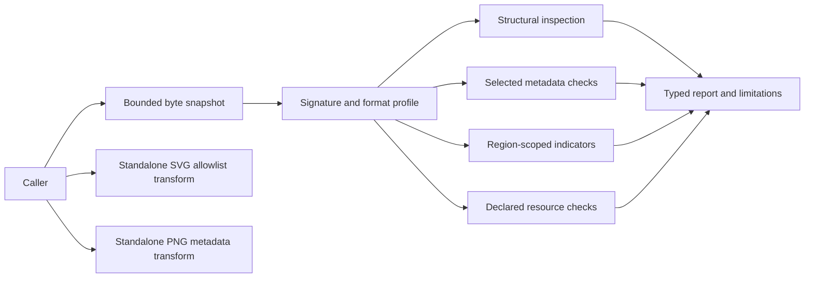

# Architecture

The JS and PHP packages are native runtime implementations. Shared JSON Schema, threat identifiers, fixtures, and expectations live under `spec/`. Byte inspectors do not invoke a decoder. Transformations are explicit standalone calls and do not mutate caller-owned input.

Trust boundaries: caller-to-library byte ingress; parser state over untrusted bytes; optional worker boundary in Node; caller-managed PHP streams; and application policy/storage after report generation. There is no network, persistent store, telemetry, or database in the core.

Capability reports are runtime-specific. PHP SVG support depends on `ext-dom`; JS currently uses Saxes. See the [TRD](02-TRD.md) and [detection coverage](security/04-Detection-Mitigation-Coverage.md) for limitations and decisions.
